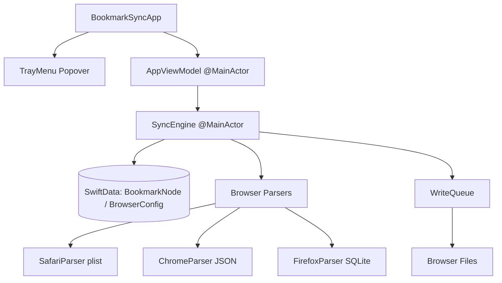

# BookmarkSync Project Self-Guidance & Architectural Record

Use this document to quickly onboard and resume development from scratch. It details the system architecture, component design, and critical, hard-earned bug fixes.

---

## 1. System Architecture



### Core Components
- **`BookmarkSyncApp.swift`**: Entry point. Sets up popover `MenuBarExtra` and launches the primary `SyncEngine` on start.
- **`TrayMenu.swift` / `BackupsView.swift`**: SwiftUI popover views. Enables toggling browser profiles, viewing backups, and displaying live diff queue logs.
- **`AppViewModel.swift`**: Unified reactive state holder. Manages list of discovered browser profiles, diff history queue, and full disk access checks.
- **`SyncEngine.swift`**: The synchronization heart. Fetches current browser bookmark trees, merges them against the global state, calculates differences, and triggers database/file updates.
- **`FileWatcher.swift`**: Wrapper around macOS `FSEvents` system. Watches active browser directories recursively on a background thread.
- **`WriteQueue.swift`**: Thread-safe serial write pipeline. Queues updates for active browsers and defer-writes them if the target browser process is running to avoid in-memory cache clobbering.

---

## 2. Hard-Earned Engineering Lessons & Bug Fixes

### A. Project Structure & Code Signing Persistence
- **The Issue**: Manual changes inside Xcode (`.xcodeproj`) were wiped out whenever `xcodegen generate` was executed.
- **The Fix**: 
  - `properties` must be nested under target `info` (not `settings`) in `project.yml` for `LSUIElement: true` to compile correctly to `Info.plist` (hiding the app from the Dock).
  - Code signing configurations must be defined in `project.yml` target `settings` to persist through generations:
    ```yaml
    settings:
      CODE_SIGN_STYLE: Automatic
      DEVELOPMENT_TEAM: MCC7MZGLZ8
    ```

### B. SwiftUI Picker Collapsing & Console Warnings
- **The Issue**: 
  - Initializing optional `@State` selection to `nil` caused a persistent console warning: *"Picker: the selection 'nil' is invalid... undefined results"*.
  - Wrapping `ScrollView` in dynamic popovers caused the height to collapse to `0`.
- **The Fix**:
  - Wrapped `Picker` inside `if selectedConfigId != nil` and populated selection immediately via parent `VStack` `.onAppear` and `.onChange(of: configs)`.
  - Set explicit ScrollView height dynamically using `min(count * 24, 150)` when items exist, rendering static text directly when empty.

### C. SwiftData Detached Context Crash
- **The Issue**: Accessing deleted/modified `BookmarkNode` entities inside the serial background write queue caused a fatal crash: *"This backing data was detached from a context without resolving attribute faults"*.
- **The Fix**:
  - Before calling `modelContext.delete` on stale database nodes, the sync engine maps/clones `merged` nodes into brand new, completely unmanaged `BookmarkNode` instances.
  - The clean unmanaged nodes are safely saved to the database and passed to the asynchronous `WriteQueue` without any active context coupling.

### D. Zero-Noise & Highly Reactive File Watching
- **The Issue**: Watching entire application support directories recursively triggered high CPU usage and loops due to unrelated browser writes (history, cookies, session restore).
- **The Fix**:
  - `SyncEngine` manages the `FileWatcher` dynamically, only watching the specific parent directories of currently *enabled* profiles.
  - In FSEvents callback, all events are strictly filtered to ignore unrelated files and trigger sync *only* when the changed path matches the exact bookmark file (`Bookmarks`, `Bookmarks.plist`, `places.sqlite`).
  - Added workspace notification observer for `NSWorkspace.didTerminateApplicationNotification` in `WriteQueue`. Pending writes are flushed instantly the moment a user closes a running browser.

### E. Unified Hierarchy Mismatch & Rename Loop Resolution
- **The Issue**: 
  - Chrome included its root folders in results (nesting child bookmarks one level deep), whereas Safari and Firefox omitted root folders (placing child bookmarks at `parentId: nil`). This mismatch caused endless delete/add loops.
  - Safari has no bookmark-level `mtime` modification timestamps, resulting in fallback `Date()` (current time) marking Safari bookmarks as "always newer" than Chrome's actual modifications.
- **The Fix**:
  - **Flattened Roots**: `ChromeParser.read()` updated to skip traversing root folders, setting immediate children to `parentId: nil`. Flat structures now align globally.
  - **Robust URL Normalization**: Added `normalizeURL` utilizing Swift `URL` parsing to ignore the protocol (`http`/`https`), host case, a leading `www.`, default ports and trailing slashes in the composite `id`. Paths, query strings, fragments and non-default ports are kept as-is (since id scheme v2; stored ids are migrated by `BookmarkIdMigration`).
  - **Safari Timestamp Pollution**: Set Safari node `mtime` fallback to a constant epoch date `Date(timeIntervalSince1970: 0)` (Jan 1, 1970).
  - **SyncEngine Rename Sorter**: Implemented logic in `SyncEngine.merge` that prioritizes renames by checking which browser changed *relative to the DB sync state* (`stateNode.title`). Conflicting dual-direction queues are resolved cleanly in a single winner direction.

### F. Lock-Resilient Sync via Observed Profile State
- **The Issue**: When `SyncEngine` dispatched writes to browsers that were currently open (e.g., Safari locking `Bookmarks.plist`), the write queued up. On the next sync cycle, comparing the old disk file against the speculative "Hub" state falsely made the engine believe the user locally *deleted* the pending items, triggering cascading deletions across all synced browsers.
- **The Fix**:
  - `SyncEngine` now strictly maintains an `observedStateData` (JSON-encoded `BookmarkNodeRecord`s) attached to `BrowserConfig`.
  - The observed state is *only* ever updated to match what is successfully parsed from the physical disk—never speculatively.
  - If a file write is blocked, the disk file matches the old observed state natively, registering `0` changes, and simply deferring the operation until the browser is closed and accepts the write.

### G. Parser Folder Normalization & Conflict Resolution
- **The Issue**: `SafariParser` generated folder IDs using unique UUIDs, while `ChromeParser` generated them using the folder's name. This caused massive duplication/deletion loops because the Hub couldn't reconcile identically-named folders across browsers. Additionally, concurrent modification (one profile deletes, another renames) heavily favored deletion.
- **The Fix**:
  - **Title-Based Folder IDs**: `SafariParser` and `FirefoxParser` now explicitly generate unique folder IDs based on their title (name), perfectly aligning with Chrome's approach. Same-named folders now cleanly merge natively in the Hub.
  - **Robust Prefix Stripping**: `BookmarkNode.stripProfileSetPrefix` was hardened using segment-splitting (max 2 splits) to prevent folder names containing colons (e.g., `My: Folder`) from corrupting the ID routing logic.
  - **Updates Trump Deletes**: Deletions are now strictly validated against `observedStateData`. If a profile attempts to delete a node that has been modified (renamed/moved) by another profile since its last sync, the deletion is rejected and the node is preserved or resurrected.

---

## 3. AI 协作规范与记忆体系（中文维护）

本节适用于参与本仓库（`JasonZhang1225/bookmarksync-cn`，中文分支）的 AI 编码代理和开发者。第 1、2 节是原作者留下的英文架构记录，保留不改；本节起用中文维护。当前工作状态见 `memory.md`，已完成工作的日志见 `history_full.md`，本阶段计划与待修复清单见 `docs/plan/`。文档与当前代码或用户最新要求冲突时，以代码和用户为准，并向用户说明冲突，不自行扩大范围。

### 3.1 文档分工与读写规则

| 文档 | 角色 | 谁写 | 写什么 | 不写什么 |
| --- | --- | --- | --- | --- |
| `AGENTS.md` | 原则 | 人工维护 | 协作方式、仓库事实、架构边界、数据安全红线、测试、交付规则 | 进度、验证结果、日期性事件 |
| `memory.md` | 实时工作记忆 | 每次任务结束时更新 | 顶部摘要、进行中的事项、当前痛点、接下来要做的事 | 已经合入的完成细节（移入日志） |
| `history_full.md` | 工作日志 | 一项工作合入或发版时追加 | 按日期追加：做了什么、为什么、验证命令与结果、实机现象、未验证边界、决策 | 待办与计划 |
| `docs/plan/*.md` | 阶段计划 | 阶段开始时写，推进中更新状态 | 本阶段目标、待修复问题清单（编号、位置、风险、修复思路、验收）、批次安排 | 实时进度细节（写 `memory.md`） |
| `DESIGN.md`、`README.md` | 原作者英文文档 | 原则上不改 | — | — |

**读写顺序**：

- 任务开始前：读 `AGENTS.md` → `memory.md` → 当前阶段的 `docs/plan/` 文件；`history_full.md` 不通读，只用 `rg` 查同类问题、同一功能的既往结论。
- 任务进行中：未合入的改动只记在 `memory.md`“进行中”；对应计划条目状态改为“进行中”并注明分支/PR。
- 一项工作合入 `main`（PR 合并）后：从 `memory.md` 移出，在 `history_full.md` **末尾**追加一条日志；计划条目状态改为“已完成（PR #N）”。不改写旧日志（事实错误时追加更正条目）。
- `AGENTS.md` 由人工维护；AI 只在用户要求时修改，改动前后向用户说明。

**日志条目格式**（`history_full.md`）：

```markdown
## YYYY-MM-DD 空读取保护（PR #N）

- 改动：……（用户可见行为 + 关键实现位置）
- 原因/决策：……（对应计划编号，如 S1）
- 验证：实际命令与结果（本地 / CI run 链接）、实机现象。
- 未验证：……
```

### 3.2 开始任何任务前

1. 按上表读 `AGENTS.md`、`memory.md`、`docs/plan/`，按需检索 `history_full.md`。
2. 运行 `git status --short` 和 `git branch --show-current`，识别并保护用户已有改动；需要最新代码时先 `git pull --ff-only`。
3. 阅读即将修改文件的调用链和对应测试，不只读目标函数。同步相关改动至少要走通：解析器 `read()` → `SyncEngine+Execute.swift` 导入阶段 → 导出阶段 → `WriteQueue` → 解析器 `write()`。
4. 明确本次涉及哪些浏览器（Safari / Chromium 系 / Firefox）、验收命令是什么。
5. 多文件或行为变化先给出简短计划；用户已明确要求直接做时可以直接实施。

默认使用中文沟通。解释新概念时先说用途和行为，再给术语与实现细节。

### 3.3 仓库事实

- 本仓库是 `Xazzzi/bookmarksync` 的 fork。`origin` = `JasonZhang1225/bookmarksync-cn`（日常推送、PR 都在这里）；上游 `Xazzzi/bookmarksync` **不推送**，需要对照上游时只读拉取。
- 分支流程：每项改动在 `feat/…`、`fix/…`、`docs/…`、`refactor/…` 分支开发，用户要求时推到 `origin` 并开 PR 合入 `main`；合并由用户决定。
- 工程由 XcodeGen 生成（`project.yml` → `BookmarkSync.xcodeproj`，后者不进 Git），macOS 14+，依赖 SQLite.swift。测试在 `BookmarkSyncTests/`（XCTest）。
- CI：`.github/workflows/macos.yml`（随 PR #1 引入）在 PR 上跑 `xcodegen generate` + `xcodebuild test`，并打包未签名的 Debug 应用。
- 本地化资源在 `BookmarkSync/Localization/{en,zh-Hans}.lproj`，动态文案走 `L10n`；新增文案两种语言同时加，并运行 `python3 scripts/check_localizations.py`（随 PR #1 引入）。
- 云端会话（Claude Code / Codex 等）通常是 Linux 容器，**无法编译和运行 Swift/macOS 代码**：只能做静态阅读与 Python 资源检查，编译和测试交给 PR CI，结论中写明“仅 CI 验证”。
- 本机验证产物（截图、日志、浏览器书签文件副本）放忽略目录 `.artifacts/`，不进 Git。

### 3.4 数据安全红线（本项目最重要的规则）

本应用直接改写用户真实的浏览器书签文件，且改动会经 iCloud / Google 同步 / Firefox Sync 扩散到所有设备。错误的代价是用户全设备丢书签，因此：

- **不确定就不写。** 解析失败、文件结构异常、读到空结果而上次不为空等情况，一律视为“读取失败、跳过本轮”，绝不解释成“用户删除了全部书签”。
- **删除必须有上限。** 单轮删除数量或比例异常时，暂停该配置组的写入并提示用户确认，不自动扩散。
- **改 ID 规则必须带迁移。** 书签身份 ID（`normalizeURL`、文件夹标题路径、`:dupN` 后缀等）一旦变化，中枢数据库和每个配置的 `observedStateData` 必须同步迁移；否则下一轮会被识别为“全部删除 + 全部新增”。
- **开发和测试不碰真实书签。** 测试只用临时目录里的 fixture；需要真实文件时先复制到 `.artifacts/` 再操作，不提交真实书签文件（`.gitignore` 已忽略 `Bookmarks`）。
- **写入前必须有备份。** 不得移除或绕过 `BrowserParser.performBackup()`；新增写入路径同样先备份。
- **与浏览器云同步的兼容性要实测。** 改动 Chrome `guid`/`checksum`、Safari `WebBookmarkUUID`、Firefox `guid`/同步字段时，没有真实账号往返验证，不得声称“兼容云同步”。
- 不在日志、截图、测试 fixture 或提交中保存用户真实书签内容、账号信息；需要示例数据时用虚构网址。

### 3.5 工作方式

- **检查优先。** 优先用 `rg`、`git`、`xcodebuild` 等只读或可复现命令；不根据函数名猜测浏览器文件格式，格式问题用真实文件副本取证。
- **每次只推进一个可验证的改动。** 一个 PR 对应 `docs/plan/` 里的一个或一组相关条目；不在修 A 时顺手重写无关的 B。
- **同步算法改动必须补测试。** 至少覆盖：新增、修改、删除、移动在三类浏览器间的传播；空读取/读取失败不导致删除；新启用的配置不删除本地书签。
- **不用“已完成”描述只编译、未运行的功能。** 本地无法构建而交给 CI 的要写明；CI 通过只证明单元测试，不证明真实浏览器和云同步行为。
- 保留用户指定的机制、文字和未提交改动；不擅自安装依赖、修改系统设置、登录账号。
- 不擅自 commit、push、创建 PR、合并；用户明确要求时才做。

### 3.6 `memory.md` 维护规则

- `memory.md` 是动态记忆，不是只追加的日志：每次任务结束都要增删改。
- 已解决的痛点删除或改写；已合入的事项移进 `history_full.md`；同一事项不能同时出现在“进行中”和“接下来”。
- 分支、未合入 PR、验证状态变化时，立即同步顶部摘要。

### 3.7 测试与验证

- 业务逻辑/解析：`xcodebuild test -project BookmarkSync.xcodeproj -scheme BookmarkSync -destination 'platform=macOS' CODE_SIGNING_ALLOWED=NO DEVELOPMENT_TEAM=`（先 `xcodegen generate`）；Linux 环境交给 PR CI。
- 文案：`python3 scripts/check_localizations.py`。
- 涉及写入逻辑的改动，至少在一台 Mac 上用**测试用浏览器配置**（不是日常配置）做一次真实写入：写入前后文件对比、浏览器重开后书签显示、云同步到另一台设备后的结果。
- “测试通过”必须附实际命令和结果（或 CI run 链接）。

### 3.8 Git 与交付

- 不使用 `git reset --hard`、`git checkout --` 覆盖用户改动；不修改无关文件，不格式化整个仓库。
- 提交信息用中文，`feat:`/`fix:`/`docs:`/`refactor:`/`test:` 等前缀。
- 每次交付说明：完成的行为、修改文件、验证命令、未验证边界和下一步。
